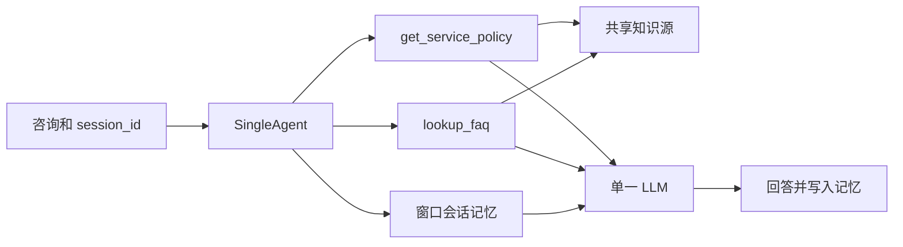
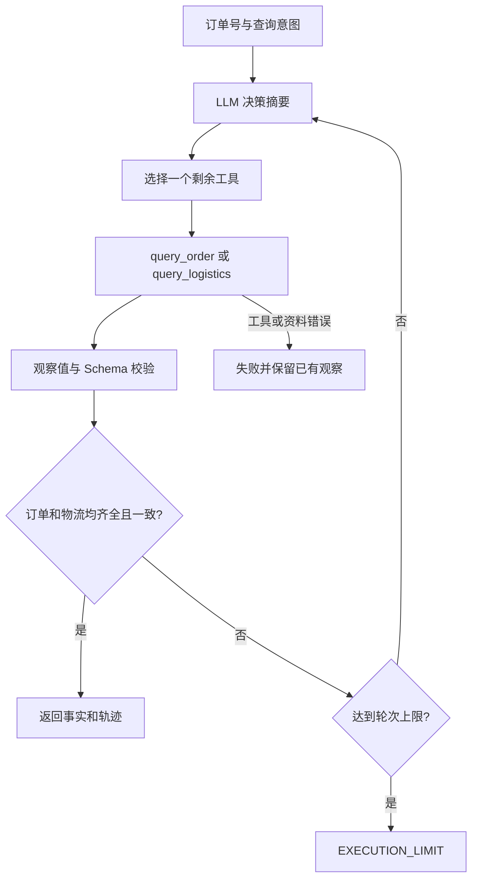
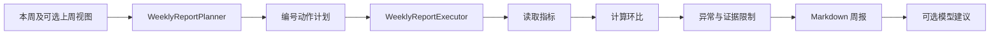
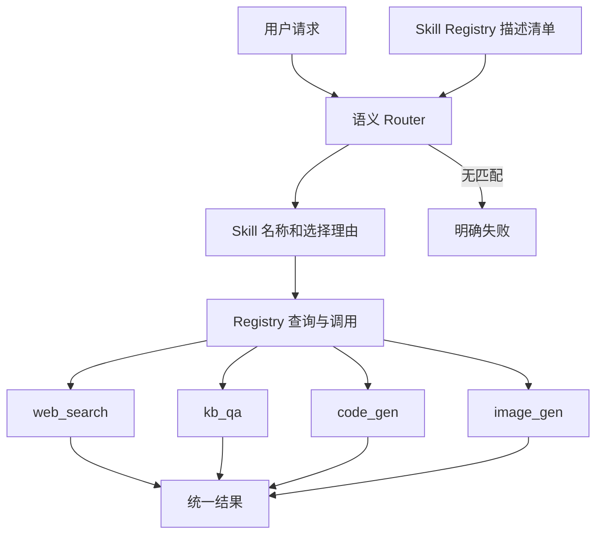
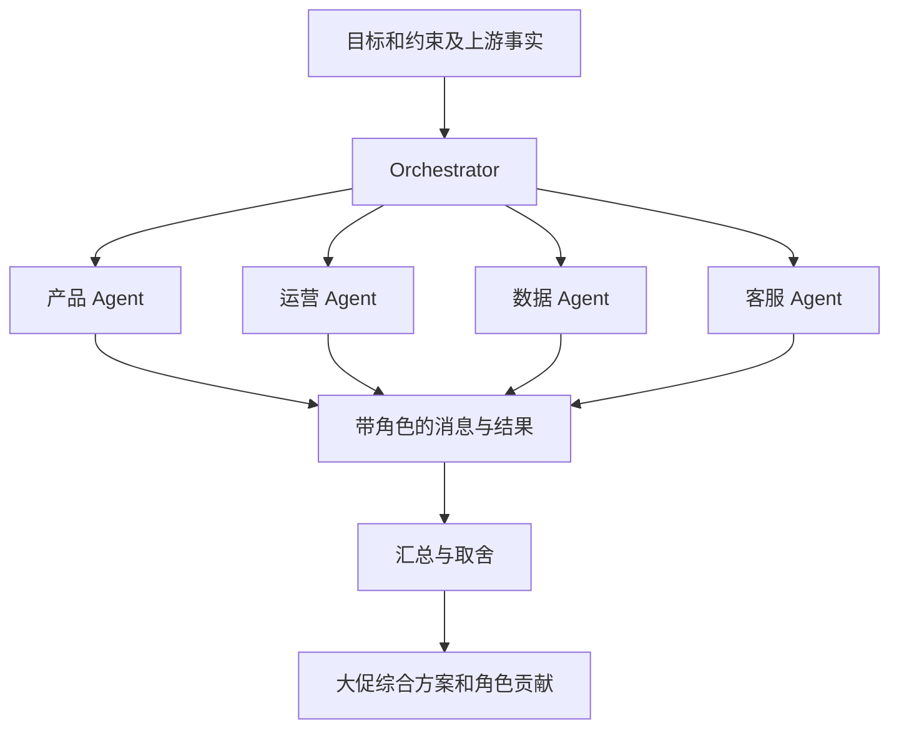
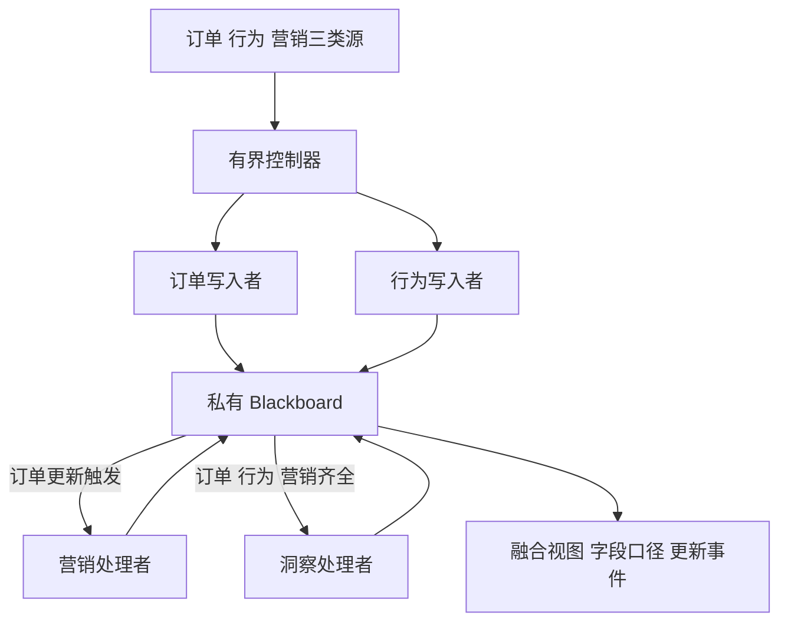
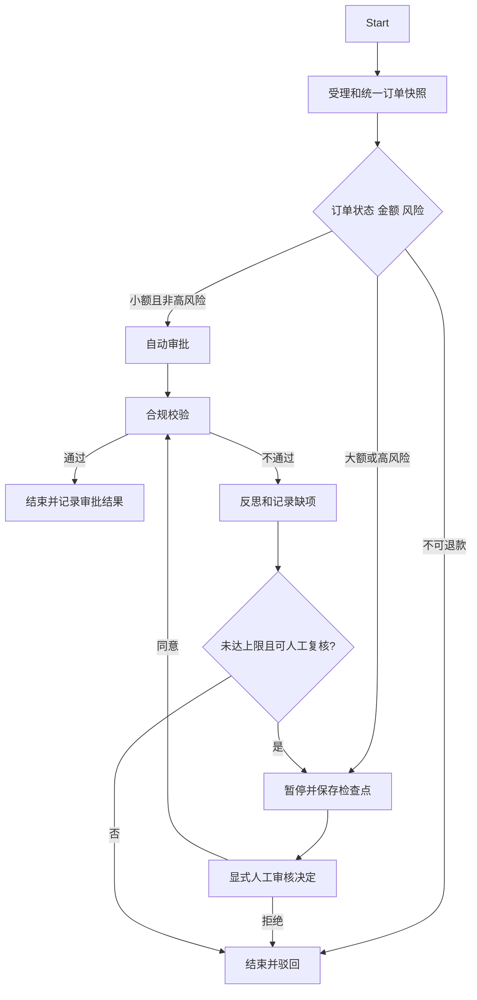
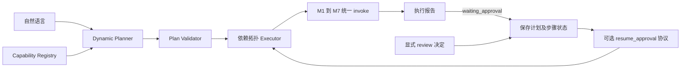

# 七种 Agent 架构与平台边界

2026-10-14，按当前实现绘制。图中“模型”在离线测试中可注入显式替身；真实路径复用公共 TextModel。模块统一对外 `invoke(AgentRequest) -> AgentResult`。

## M1：Single Agent

对应 `agents/single_agent.py`。两个工具分别检索 FAQ/服务政策；明确指代的追问可以使用窗口内用户问题定位主题。无命中返回资料缺失证据，闲聊不因此失败；源文件错误仍明确失败。业务冲突保留来源和提示，不由模型裁定权威。

## M2：ReAct

对应 `agents/react_agent.py`。输出公开决策摘要、Action、Observation、停止原因；不暴露模型隐藏推理。订单号由程序固定，模型只能选择工具。仿真订单由公共数据源提供。

## M3：Plan & Execute

对应 `agents/plan_execute.py`。规划与执行有独立类；环比由代码计算，模型建议标注待验证。相邻上周必须通过统一输入传入；独立入口可用 `common/weekly_data.py` 读取同口径视图，不导入其他 Agent 私有实现。

## M4：Router + Skill

对应 `agents/router/`。搜索与生图可接百炼；知识检索读取本地资料；代码生成不执行代码。新增 Skill 实现并注册即可，Router 没有按四个名称硬编码分发。

## M5：Multi-Agent

对应 `agents/multi_agent.py`。四角色执行及汇总均有记录；事实来自显式输入，不读取其他模块私有状态。离线演示注入 FakeLLM，只验证协作结构，不代表营销质量已验收。

## M6：Blackboard

对应 `agents/blackboard.py`。黑板仅属于一次 M6 调用；订阅触发队列，读/处理/写/响应事件可检查。计算函数可共享，但 Blackboard 和队列不共享给 M3。

## M7：LangGraph Workflow

对应 `agents/workflow/`。金额阈值 50000 分；高风险小额必须核验材料。检查点支持同进程恢复、轨迹和流程状态回滚；不执行支付，也不宣称回滚可撤销真实打款。

## 平台补充：规划、执行与审批续跑

恢复时校验原关联 ID 与输出 Schema，只运行新就绪的 pending 步骤；已完成步骤不重跑，等待不是成功。没有 M7 名称特判。只支持同进程、串行调用；重启后的持久化恢复不属于本次实现。
