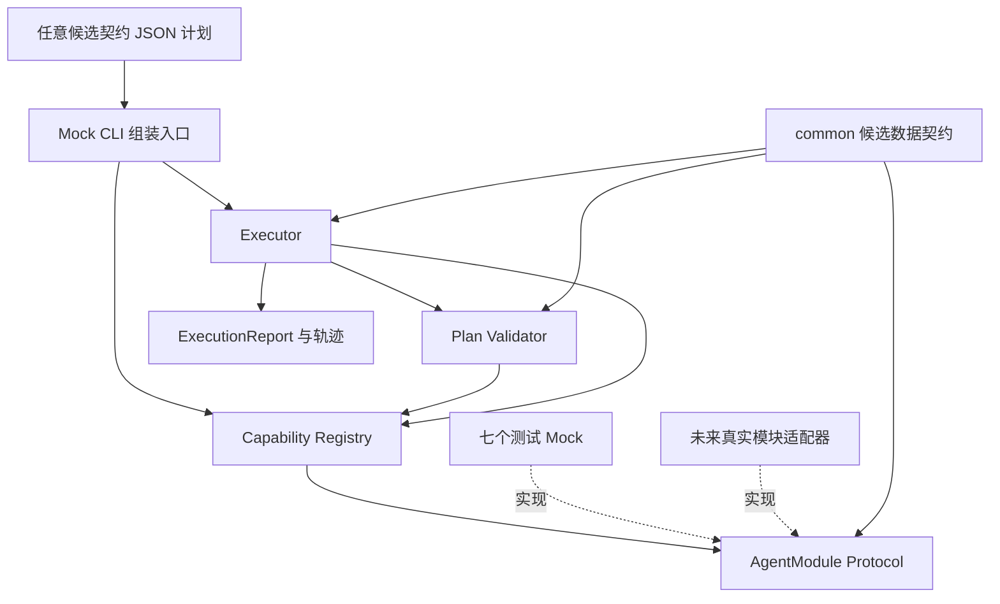

# 第一阶段架构

这是平台基础框架图，不是原始课程要求的七张真实 Agent 架构图。真实七架构尚未实现。

依赖方向：common 无业务/平台依赖；平台 Registry 保存 Manifest 快照和 Protocol 实例；Validator 只读取注册的 Schema；Executor 调用注册的接口。
Mock 提供业务数据和 Manifest，CLI 负责把 Mock 注册到平台；核心调度器没有 M1–M7 名称分支，也没有自然语言匹配逻辑。
Manifest 业务 Schema 检查由轻量 `schema.py` 负责，实际值检查交给 jsonschema，模型结构由 Pydantic 负责。

执行顺序：先完整验证计划，再按稳定拓扑排序执行。数组顺序只用于同批可执行步骤的平局排序，不能覆盖依赖。
解析引用后复制输入并做 Schema 校验，再调用模块，验证返回关联字段和输出 Schema，最终记录结果。
失败阻断依赖链；等待阻塞依赖链；不相关分支继续。每次执行创建独立记录，不共享模块间私有状态。

临时工程决定：同步串行、内存状态、无自动重试、无恢复、无持久化。阶段一只验证确定性计划执行，避免提前引入 Redis/Celery/数据库或工作流框架。

扩展入口：注册新 Manifest + Adapter。未来 Planner 读取 Manifest 生成 ExecutionPlan，继续复用已有 Validator / Executor。
真实模块的 ReAct、M3 内部规划、M4 Skill 路由、M5 角色协作、M6 Blackboard、M7 StateGraph 均位于各模块内部，平台不干预。
