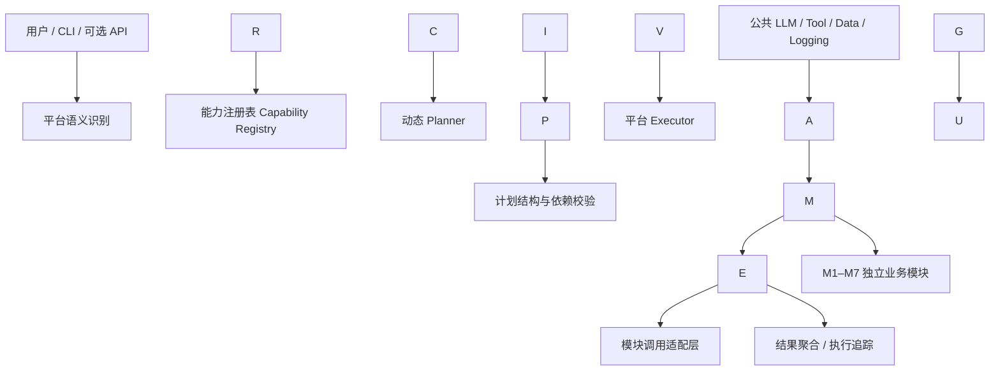
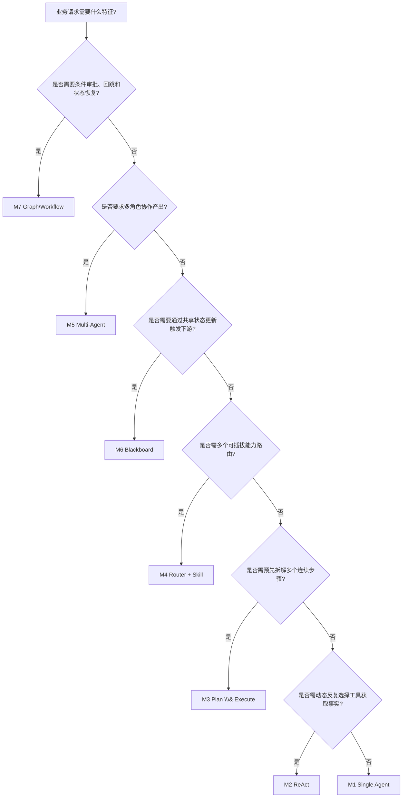

# 企业级「智能运营中枢」Agent Hub

**产品需求文档（PRD）｜v0.1 评审草案**

|文档属性|内容|
|-|-|
|项目代号|Agent Hub / 智能运营中枢|
|业务背景|星潮电商（课程案例中的虚拟业务主体）|
|文档版本|v0.1（待小组评审，尚未冻结）|
|编写日期|2026-10-12|
|文档负责人|待确定（项目经理 / 需求负责人）|
|适用对象|小组成员、技术负责人、测试负责人、答辩演示人员|
|来源基线|《项目作业：企业级「智能运营中枢」Agent 平台（七大架构综合实战）》|
|项目立场|七种 Agent 架构独立完整；平台层支持基于用户任务的动态跨模块编排|

> \\\*\\\*阅读标记\\\*\\\*：\\\*\\\*【作业必做】\\\*\\\*表示来自原始作业的要求；\\\*\\\*【团队方案】\\\*\\\*表示本 PRD 建议采用、需团队评审的设计；\\\*\\\*【待决策】\\\*\\\*表示信息尚不充分，不能据此直接冻结实现。文中接口与技术设计均为 v0.1 候选契约，尚未经过小组确认。

## 0\. 执行摘要

### 0.1 一句话定义

构建面向电商运营场景的模块化 Agent Hub：M1–M7 分别独立实现七种 Agent 架构和对应业务能力；平台通过能力注册、语义识别、动态任务规划与执行调度，在运行时组合多个模块完成复合业务任务。

### 0.2 两条成功主线

1. **架构教学验收【作业必做】**：七种架构均有实际代码、能够独立运行，核心控制流可被日志和测试证明；选型理由完整，不以相似代码或仅替换 Prompt 充数。
2. **平台集成验收【团队方案】**：模块遵守稳定契约，平台能够依据自然语言任务动态挑选模块、生成结构化执行计划、传递结果并处理失败或暂停；至少提供两条不同组合关系的可复现演示任务。

### 0.3 最重要的边界

* 每个模块是一个**可独立完成本职业务的能力单元**，不直接调用其他 M 模块的内部函数。
* 平台协调“**调用谁、按什么依赖关系调用、怎样处理结果**”，不接管模块内部的 ReAct、Plan\&Execute、Multi-Agent 或 Graph 控制逻辑。
* 公共基础设施可以共享；模块私有状态、Prompt、计划和业务决策保持隔离。
* v1 优先实现**最小必要工程控制**，不提前搭建复杂安全体系或分布式基础设施。

\---

## 1\. 业务背景、价值目标与度量

### 1.1 案例现状【作业必做】

课程案例设定为“星潮电商”：日均订单 **12 万单**，客服团队 **40 人**、运营团队 **15 人**。七类业务痛点与对应方向如下。

|业务痛点|案例现状|案例业务目标|对应模块|
|-|-|-|-|
|FAQ 重复咨询多|客服 60% 问题为重复 FAQ；人工日处理 3000 会话|AI 承接 70% 简单会话|M1|
|订单/物流/库存多系统切换|单次查询平均 90 秒|单次对话查数降至 10 秒|M2|
|运营周报耗时|六个数据源；每周约 8 人时|自动生成结构化周报|M3|
|通用 AI 工具分散|搜索、知识库、代码、生图入口各异|统一网关按需分发|M4|
|大促跨部门协商耗时|方案评审周期 5 天|缩短至 1 天|M5|
|数据口径割裂|订单、行为、营销模块独立|共享状态、口径一致|M6|
|退款/合规审批不透明|差错率 3%；无回滚审计|流程固化、监控和回滚|M7|

**度量解释**：上述数值是案例背景给出的**业务愿景**，不是可以仅凭课程 Demo 证明的生产效果。作业验收以功能、架构特征、测试和演示为主；如需验证 70% 承接率、90→10 秒、5→1 天或 3% 差错率，必须另行确定真实样本、基线和评测周期。【待决策】是否将任何业务愿景转为小组的量化测试门槛。

### 1.2 V1 产品目标

* G1：M1–M7 均可独立启动、独立执行、独立测试。【作业必做】
* G2：各模块确实体现对应 Agent 架构的行为差异；提供可检查的执行证据。【作业必做】
* G3：公共数据类型、工具协议、结果协议和错误约定统一，不将模块内部状态暴露给其他模块。【团队方案】
* G4：平台对复合自然语言任务动态生成计划，而非预先硬编码固定模块链。【团队方案】
* G5：至少两种不同的模块组合流程可在模拟数据上稳定演示，支持失败可见和必要暂停恢复。【团队方案】
* G6：按作业要求完成文档、代码、测试和答辩交付。【作业必做】

### 1.3 V1 非目标【团队方案】

* 不建设生产级微服务、Kubernetes、消息队列集群、多租户 IAM、完整计费系统。
* 不承诺接入企业真实订单系统或真实退款支付接口；优先使用统一 Mock / Fixture，真实服务由适配器可选接入。
* 不追求任意工具、任意代码、任意外部网站的无限自主执行；仅动态编排已注册且被允许的能力。
* 不以平台级统一状态代替 M6 的内部 Blackboard，也不以平台 Planner 代替 M3 的 Planner。
* 不以增加多层 Guardrail、重复审查 Agent 作为初始开发工作的默认内容。
* 不把全量前端、大屏或复杂部署作为七架构验收的前置条件。

## 2\. 用户角色与典型业务场景

|角色|主要目标|入口示例|预期结果|
|-|-|-|-|
|客服人员|快速回答政策、查询订单物流|“查询订单 2025101234 的物流”|可核对的订单/物流状态|
|运营人员|分析经营与生成周报|“生成第 41 周运营周报”|结构化报告和数据依据|
|营销协作人员|跨职能策划大促|“根据本周分析制定大促方案”|产品、运营、数据、客服综合方案|
|审核人员|审批较高金额退款|“审核退款申请 R-001”|审核待办、决策记录、流程恢复|
|平台使用者|处理跨领域复杂任务|“分析经营异常并提出促销方案”|运行时计划、多个模块的结果汇总|
|开发/测试人员|独立开发和验收能力模块|CLI、测试命令、契约测试|运行轨迹、状态、测试证据|

### 2.1 单能力任务

自然语言请求可直接映射到一个模块，例如订单查询由 M2 执行；无需强制生成包含多个模块的计划。

### 2.2 复合任务：经营分析与营销策划【团队方案】

用户：“融合本周订单、行为和营销数据，产出周报，再依据异常提出下周大促方案。”

可能的运行时计划为 **M6 → M3 → M5**。这只是测试用例中期望的合理编排之一，不能在生产代码中将该语句的模块顺序写死。规划器需根据能力描述、输入条件及任务语义生成步骤与依赖关系。

### 2.3 复合任务：订单查询与退款处理【团队方案】

用户：“查询订单 2025101234，符合条件的话发起退款申请。”

可能的计划为 **M2 → M7**；M7 自己决定金额条件分支和审批流程。若金额大于 500 元，平台将任务标记为等待人工审核，而不是把等待当作普通错误，也不替审核人员自动同意。

### 2.4 业务边界原则

同一请求若需多个能力，由平台级编排统一调用；M2 不直接导入 M7 的代码，M6 不直接修改 M3 的计划状态。M4 的 Skill Router 是**能力网关内部路由**，不等同于平台对 M1–M7 的顶层路由。

## 3\. 功能范围与优先级

### 3.1 功能范围总览

|ID|能力|优先级|来源|独立验收|
|-|-|-|-|-|
|M1|单 Agent 智能客服|P0|作业必做|必须|
|M2|ReAct 订单/物流实时查询|P0|作业必做|必须|
|M3|Plan \& Execute 运营周报|P0|作业必做|必须|
|M4|Router + Skill 网关|P0|作业必做|必须|
|M5|Multi-Agent 大促协作|P0|作业必做|必须|
|M6|Blackboard 多源数据融合|P0|作业必做|必须|
|M7|Graph/Workflow 退款审批|P0|作业必做|必须|
|P1|Capability Registry|P0|团队方案|合同/注册测试|
|P2|平台级语义识别与动态 Planner|P0|团队方案|计划生成测试|
|P3|依赖调度 Executor / Result Aggregator|P0|团队方案|跨模块集成测试|
|P4|执行追踪、失败终止、有限重规划|P1|团队方案|异常/恢复测试|
|UI|可视化前端|P2|团队方案|不作为 P0 前置条件|

**优先级说明**：P0=必须完成，P1=主链成功后完善，P2=时间允许时做。平台动态编排属于团队自主增加的 P0 目标，必要时需通过项目变更流程重新评估，不得牺牲作业原生七模块验收。

### 3.2 模块需求规格

#### M1｜单 Agent FAQ 智能客服

* **输入**：自然语言咨询、会话标识、可配置记忆窗口。
* **处理**：单一 LLM Agent 结合会话记忆和**至少 2 个简单工具**响应多轮 FAQ 或闲聊。【作业必做】
* **输出**：用户可读的直接回答；在平台模式下包装为统一结果对象。
* **边界**：不承担 M2 的实时订单查询，不调用 M7 的退款执行流程。
* **推荐工具【团队方案】**：`lookup\\\_faq`、`get\\\_service\\\_policy`（二者均为只读 Mock 工具，可调整）。
* **验收**：AC-M1-01 连续提问可体现上下文；AC-M1-02 两个工具均能被触发并记录；AC-M1-03 可独立启动 `single\\\_agent.py`。

#### M2｜ReAct 实时订单与物流查询

* **输入**：含订单号的自然语言任务；示例“查订单 2025101234 的物流到哪了”。
* **处理**：显式的“决策摘要 → Action → Observation → 是否达标”循环，按需调用 `query\\\_order`、`query\\\_logistics`；最多执行配置的 N 轮。【作业必做】
* **输出**：订单/物流事实、简明回答、行动与观察记录、终止原因。
* **日志解释**：原始作业要求 Thought/Action/Observation 完整轨迹。实现采用**面向审计的决策摘要**记录 Thought 对应阶段，而不依赖暴露模型隐藏推理；Action、Observation、停止条件必须完整可复现。【团队方案；答辩口径需确认】
* **验收**：AC-M2-01 正常查询；AC-M2-02 订单不存在；AC-M2-03 工具暂不可用；AC-M2-04 轮次耗尽明确退出；AC-M2-05 可展示完整动作轨迹。

#### M3｜Plan \& Execute 运营周报

* **输入**：周期标识（第 X 周）及可选结构化经营数据。
* **处理**：Planner 生成带编号的周报计划（销售拉取→环比分析→异常归因→报告生成）；Executor 按步骤执行并记录结果。两者保持清晰的类/函数边界。【作业必做】
* **输出**：Markdown 运营周报、步骤执行记录、数据口径说明。
* **边界**：M3 内部 Planner 只规划周报步骤，不决定其他 M 模块的调用序列。
* **验收**：AC-M3-01 输出可执行编号计划；AC-M3-02 执行顺序可核对；AC-M3-03 周报含统计、环比与异常解释；AC-M3-04 单独运行。

#### M4｜Router + Skill 统一能力网关

* **输入**：对搜索、知识库问答、代码生成、生图之一的能力请求。
* **处理**：Skill 注册表 + 统一调用接口 + Router 分类分发；支持至少 **4 个 Skill**：联网搜索、企业知识库问答、代码生成、图片生成；新增 Skill 不修改 Router 主逻辑。【作业必做】
* **输出**：被选 Skill 的结构化业务结果和选择记录。
* **兜底**：识别不明确时返回明确的无法路由结果或要求补充信息，不擅自调用任意 Skill。
* **外部依赖【待决策】**：联网搜索和生图是接真实服务、可重放 Mock，还是同时提供两种适配器；演示前必须确认教学验收接受程度。
* **验收**：AC-M4-01 四类能力均能被正确选择；AC-M4-02 动态注册第 5 个测试 Skill 不改 Router 主逻辑；AC-M4-03 未匹配任务触发兜底。

#### M5｜Multi-Agent 大促方案协同

* **输入**：大促目标、时间、预算等可选约束，及前序分析结果。
* **处理**：由 M5 内部 Orchestrator 分配任务给**产品、运营、数据、客服**四个专业 Agent；存在消息传递、必要的并行/串行依赖和统一汇总。【作业必做】
* **输出**：一份可读的大促综合方案，包含四角色的责任内容与决策依据。
* **边界**：M5 内部 Orchestrator 不承担平台层对 M1–M7 的跨模块编排。
* **验收**：AC-M5-01 四角色均有实际任务；AC-M5-02 日志可展示消息传递；AC-M5-03 产生综合方案且不是四段无关文本的简单拼接。

#### M6｜Blackboard 多源数据融合

* **输入**：订单、用户行为、营销活动三类数据，或相应的模拟数据源。
* **处理**：定义 M6 私有 Blackboard；至少 2 个 Agent 读取/处理/写入黑板，至少 1 个 Agent 依赖其他 Agent 写入结果后继续；日志呈现读→处理→写回→触发响应。【作业必做】
* **输出**：融合后的经营视图、字段口径、更新事件与完整协作记录。
* **边界**：Blackboard 是 M6 的内部架构对象；不作为平台其他六个模块可任意写入的全局变量。
* **验收**：AC-M6-01 三类数据进入黑板；AC-M6-02 双写入者；AC-M6-03 下游依赖更新再运行；AC-M6-04 事件顺序可验证。

#### M7｜Graph / Workflow 退款合规审批

* **输入**：退款申请（申请号、订单号、金额、原因等）及可选审核决策。
* **处理**：基于 **LangGraph** 的 StateGraph：Start→受理→金额分支（**≤500 自动过；>500 人工审核**）→合规校验→不通过时有限反思回跳→结束。【作业必做】
* **输出**：审批结果、流程节点轨迹、全局 State 的必要视图、状态恢复结果。
* **暂停与恢复【团队方案】**：人工审核需要可表达“等待审批”的生命周期状态，批准/拒绝后恢复流程。
* **回滚语义【待决策】**：V1 优先演示从检查点恢复/回退 **Agent 流程状态**；不承诺已发起的外部支付退款会被自动撤销。真实外部副作用需另行设计补偿操作。
* **验收**：AC-M7-01 ≤500 自动通过分支；AC-M7-02 >500 进入等待人工审核；AC-M7-03 审核后恢复；AC-M7-04 合规失败触发有限回跳；AC-M7-05 checkpoint 恢复和轨迹查询。

## 4\. 平台级动态编排（新增项目能力）

### 4.1 架构与职责【团队方案】



* **平台 Router**：区分明确单能力、复合任务、不可识别请求；不决策模块内部流程。
* **Capability Registry**：向 Planner 提供可用能力、任务描述、输入输出 Schema、执行模式与副作用信息。
* **Dynamic Planner**：依据请求及注册信息生成**运行时结构化执行计划**；不能将业务案例硬编码为固定模块链。
* **Plan Validator**：验证能力存在、必填输入、类型、依赖引用、无循环和步骤上限；这是基本执行正确性保障，不引入额外安全 Agent。
* **Executor**：按依赖拓扑调度独立模块，记录状态、传递结果；能够并行运行无依赖步骤（并行可在 v1 后期启用）。
* **Aggregator**：保留原始模块结果及来源，汇总成最终可读答复。

### 4.2 动态性与可组合性验收

* PC-01：相同平台入口处理**单模块请求**与**多模块请求**，生成不同计划。
* PC-02：至少两项语义不同的复合任务，产生不同模块集合或不同依赖图；不能仅匹配固定关键词后返回写死链路。
* PC-03：Planner 只选择注册表声明的能力；新增兼容模块的注册信息后，无须修改 Planner 的模块名分支逻辑。
* PC-04：步骤之间按声明的输入引用完成数据传递，不直接共享 Python 内部对象。
* PC-05：前置步骤失败时，下游依赖步骤不被误执行；结果包含失败来源及终止原因。
* PC-06：M7 返回等待人工审核时，平台可以保留待续任务，而不是持续忙等或错误标记为成功。
* PC-07：七个模块在不启动平台 Router/Planner 时仍可独立运行。【同时保障作业要求】

### 4.3 运行时执行规则

1. 平台根据请求判断直接调用单模块，或进入动态规划。
2. Planner 输出完整结构化计划，包括步骤 ID、目标能力、输入绑定和依赖列表。
3. Validator 在执行前进行最小结构与依赖校验；校验失败返回可诊断错误，允许**有限次**重新规划（默认次数待确认）。
4. Executor 将步骤状态划分为 `pending`、`running`、`completed`、`failed`、`waiting\\\_approval`、`skipped`。
5. 各步骤调用统一能力接口。能力本身可以在内部使用循环、黑板、多个 Agent 或 LangGraph，不受平台影响。
6. 步骤失败时，停止依赖该结果的下游步骤；是否重规划由显式策略决定，不能静默吞错或伪造成功。
7. 输出包含最终汇总、步骤状态、核心业务数据引用和追踪 ID。

### 4.4 平台与 M4 / M3 / M5 的边界

|组件|负责什么|不负责什么|
|-|-|-|
|平台 Dynamic Planner|M1–M7 的选择、跨模块依赖|周报内部计算步骤、四角色分工|
|M3 Planner|运营周报任务的内部计划|平台其他业务模块调度|
|M4 Router|四类（或更多）Skill 的选择与注册|对 M1–M7 的顶层业务分发|
|M5 Orchestrator|产品/运营/数据/客服内部协作|其他六个模块的编排|
|M6 Blackboard|融合数据时的局部共享状态|平台所有任务的全局可写黑板|
|M7 StateGraph|退款审批的节点和状态机|平台层的任意跨模块执行图|

## 5\. 公共接口与数据契约（ICD v0.1 候选）

> 本章定义\\\*\\\*模块外部\\\*\\\*必须达成的一致性，避免规定模块内部所有函数。经团队评审后，可将本章独立维护为 `docs/interface\\\_contract.md`。此处字段与命名是推荐起点，\\\*\\\*尚未冻结\\\*\\\*。

### 5.1 公共调用协议

建议采用 Python 类型模型（如 Pydantic）表达，具体实现可为同步或异步，但应由适配层对平台统一，禁止各模块随意返回字符串、字典或不兼容对象。

```python
from typing import Literal, Protocol
from pydantic import BaseModel, Field

class AgentRequest(BaseModel):
    request\\\_id: str
    task\\\_id: str
    capability\\\_id: str
    payload: dict
    context: dict = Field(default\\\_factory=dict)  # 限非敏感的关联元数据

class AgentResult(BaseModel):
    request\\\_id: str
    capability\\\_id: str
    status: Literal\\\["completed", "failed", "waiting\\\_approval"]
    data: dict | None = None
    error: dict | None = None
    trace\\\_id: str
    continuation\\\_token: str | None = None

class AgentModule(Protocol):
    def invoke(self, request: AgentRequest) -> AgentResult: ...
```

**接口原则**：每个模块必须有统一的 `invoke` 适配入口；实际实现可异步，平台负责适配。只有确实支持暂停/恢复的模块才需要额外 `resume` 能力，不强制所有模块继承巨大的公共 Agent 父类。

### 5.2 能力清单 Capability Manifest

每个模块向平台声明：

|字段|目的|必需|
|-|-|-|
|`capability\\\_id` / `version`|唯一标识与契约版本|是|
|`name` / `description`|给 Planner 的业务能力描述|是|
|`input\\\_schema` / `output\\\_schema`|输入输出数据契约|是|
|`preconditions`|前置条件，如必须存在订单号|是|
|`side\\\_effects`|只读、修改模拟业务状态、需要批准|是|
|`execution\\\_mode`|即时完成、可能等待/恢复|是|
|`supports\\\_resume`|是否暴露恢复入口|是|
|`owner`|负责维护和协调接口变更的角色|是|

例：`m2.order\\\_tracking`、`m3.weekly\\\_report`、`m7.refund\\\_approval`。能力命名以**业务能力**而非底层架构命名，使 Planner 根据任务而非技术术语进行选择。

### 5.3 结构化执行计划 Execution Plan

```json
{
  "plan\\\_id": "plan-demo-001",
  "goal": "融合本周数据并制定大促方案",
  "steps": \\\[
    {
      "step\\\_id": "s1",
      "capability\\\_id": "m6.data\\\_fusion",
      "depends\\\_on": \\\[],
      "inputs": {"week": {"literal": "2026-W41"}}
    },
    {
      "step\\\_id": "s2",
      "capability\\\_id": "m3.weekly\\\_report",
      "depends\\\_on": \\\["s1"],
      "inputs": {"fused\\\_data": {"ref": "s1.data.fused\\\_data"}}
    },
    {
      "step\\\_id": "s3",
      "capability\\\_id": "m5.promotion\\\_plan",
      "depends\\\_on": \\\["s2"],
      "inputs": {"report": {"ref": "s2.data.report\\\_markdown"}}
    }
  ]
}
```

**规范要求**：

* `depends\\\_on` 是步骤的明确依赖，不代表自然语言出现顺序。
* `inputs` 仅允许受支持的字面值或上游输出引用；引用必须指向已存在的上游步骤和已声明输出字段。
* Planner 可生成不同数量与顺序的步骤，但不能直接将 Python 代码塞进计划。
* `step\\\_id` 在单计划内唯一；计划无循环；所有引用需满足数据类型兼容。
* 上述 JSON 是示例，字段名与枚举在 ICD 评审后冻结；示例不等于预设固定业务链。

### 5.4 数据所有权与变更边界

|业务对象|建议所有者|可读者|写入/副作用原则|
|-|-|-|-|
|订单基础事实|公共 Mock 订单数据源 / 适配器|M2、M6、M7|M2、M6 只读；M7 不直接篡改订单基础记录|
|物流状态|物流工具适配器|M2|M2 只读|
|运营融合结果|M6 输出|M3、M5、平台|通过返回结果传递，不暴露 Blackboard 实例|
|周报|M3 输出|M5、平台|M5 消费报告，不修改 M3 内部执行记录|
|大促方案|M5 输出|平台|按统一格式提交结果|
|退款审批 State|M7|平台读摘要/查询状态|状态转换仅由 M7 负责；人工审核通过恢复入口进入|
|平台任务状态|平台 Executor|平台 API/CLI|各 M 模块不得直接写平台 Task State|

### 5.5 错误、日志与生命周期约定

* `completed`：业务成功，`data` 包含模块定义的结果。
* `failed`：显式失败，`error` 至少具有 `code`、`message`、`retryable`。
* `waiting\\\_approval`：正常的业务挂起状态，必须返回恢复所需标识；不能视为成功，也不等同失败。
* 建议基础错误码：`INVALID\\\_INPUT`、`NOT\\\_FOUND`、`TOOL\\\_UNAVAILABLE`、`DEPENDENCY\\\_FAILED`、`EXECUTION\\\_LIMIT`、`CONTRACT\\\_MISMATCH`、`INTERNAL\\\_ERROR`。具体集合待 ICD 评审。
* 最少日志字段：`trace\\\_id`、`task\\\_id`、`capability\\\_id`、`step\\\_id`、时间、状态、工具名/节点名、错误码（若存在）。
* 运行日志应能定位原始错误，但不应向最终用户原样返回密钥、完整堆栈或隐藏模型推理内容。
* 超时、重试应有**单一责任归属**；避免平台、模块、工具适配器三层都自动重试同一失败请求。【待决策：默认策略】

### 5.6 契约示例：订单查询工具

```python
from typing import Protocol
from pydantic import BaseModel

class OrderQueryRequest(BaseModel):
    order\\\_id: str

class OrderQueryResponse(BaseModel):
    order\\\_id: str
    order\\\_status: str
    tracking\\\_number: str | None = None

class OrderQueryTool(Protocol):
    def query\\\_order(self, request: OrderQueryRequest) -> OrderQueryResponse: ...
```

**必须覆盖的契约测试**：正常命中、未命中、输入缺失、工具不可用；输出字段类型一致；Mock 与真实适配器（如后续接入）遵守同一契约。未命中是业务结果还是 `NOT\\\_FOUND` 错误，需要接口评审统一。

## 6\. 技术架构与选型论证

### 6.1 选型原则【团队方案】

1. 先以业务行为、可验证控制流和作业验收点选择 Agent 架构，再选择开发框架。
2. 公共基础设施轻量共享；模块私有算法、计划和状态各自实现。
3. Python 3.10+；M7 必须使用 LangGraph；项目需体现 LangChain/LangGraph 技术栈和任一 LLM API；具体库组合以兼容性测试结果为准。【技术栈基线来自作业】
4. 优先“模块化单体 + 清晰契约 + CLI 演示”，暂不引入微服务或复杂前端作为前置条件。
5. 可用确定性 Mock 验证流程，涉及模型行为时保留真实 LLM 运行路径与测试记录。

### 6.2 七种架构的快速选型决策树【作业必做】



这是**模块业务选型的解释工具**，不是平台规划器的硬编码流程；复合任务允许同时选择多种能力。

### 6.3 选型理由与不选其他架构的理由

|模块|选择该架构的原因|主要排除理由|
|-|-|-|
|M1 Single Agent|FAQ/闲聊以简短多轮问答为主，工具少|引入多 Agent 或复杂 Workflow 成本高且无必要|
|M2 ReAct|查询所需工具随观察结果动态变化，可展示决策-行动循环|单次无工具 LLM 难获得实时订单事实；固定计划灵活性不足|
|M3 Plan \& Execute|周报天然有可解释的分步计划和执行过程|仅 ReAct 易让长期报告步骤混在临时工具循环中|
|M4 Router + Skill|多种独立能力需可注册、可扩展和可路由|单体硬编码分支不利于新增 Skill；Multi-Agent 不解决插件机制|
|M5 Multi-Agent|跨产品/运营/数据/客服形成专门分工与协作|单 Agent 难体现真实角色协商；单一路由不进行协同|
|M6 Blackboard|多数据处理者通过共享工作区依赖彼此的更新|简单串行传参不足以展示共享状态与触发响应|
|M7 Graph/Workflow|审批条件、回跳、状态保持和恢复是核心|自由 ReAct 不适合可验证的审批状态机；作业明确要求 LangGraph|

### 6.4 初步技术候选【待团队评审】

* **语言/质量**：Python 3.10+、类型注解、`pytest`、环境变量配置。
* **数据契约**：Pydantic 模型 / Python `Protocol`；Mock fixtures 独立文件管理。
* **LLM**：公共 Adapter 隔离供应商 SDK，各模块允许配置不同 Prompt；至少一个可调用的 LLM API。
* **M7**：LangGraph `StateGraph`、条件边、检查点机制；实际存储后端由演示要求和环境决定。
* **平台执行**：先用轻量 Python 调度和结构化计划，不默认增加第二套大型编排框架。
* **演示入口**：七模块 CLI + 一个跨模块平台 CLI；Web 交互为可选增强。

### 6.5 推荐目录组织【团队方案，非冻结】

```text
agent-hub/
├── README.md
├── requirements.txt
├── .env.example
├── docs/
│   ├── requirement.md               # 本 PRD，保留作业要求的文件名
│   ├── architecture.md              # 七张 Mermaid 架构图
│   ├── interface\\\_contract.md        # 契约冻结后独立维护
│   └── collaboration.md             # 分工、分支与变更规则
├── agents/
│   ├── single\\\_agent.py              # M1
│   ├── react\\\_agent.py               # M2
│   ├── plan\\\_execute.py              # M3
│   ├── router/                      # M4 与 skills/
│   ├── multi\\\_agent.py               # M5
│   ├── blackboard.py                # M6
│   └── workflow/                    # M7 / LangGraph
├── platform/                        # 团队增加的跨模块编排层
│   ├── registry.py
│   ├── planner.py
│   ├── executor.py
│   └── entrypoint.py
├── common/                          # 工具/LLM/日志/数据契约
├── data/fixtures/                   # 可复现 Mock 数据
└── tests/
    ├── unit/
    ├── contract/
    └── integration/
```

## 7\. 非功能需求与最低安全边界

### 7.1 解耦与独立性

* NFR-01：M1–M7 均可不依赖平台动态规划器独立启动；各模块至少一条自动化测试。【作业必做】
* NFR-02：模块不直接导入其他 M 模块的私有实现，数据经公共契约传递。【团队方案】
* NFR-03：共享包仅容纳被多个模块真实使用的基础设施和稳定类型，避免无需求提前抽象。【团队方案】

### 7.2 可靠性与可观测性

* NFR-04：关键链路有结构化日志，异常有明确兜底，不隐匿错误。【作业必做】
* NFR-05：LLM、工具调用和规划循环均有可配置上限；避免无界调用造成卡死和费用失控。【团队方案】
* NFR-06：可用固定 Mock 重放验收路径，同时保留真实 LLM 调用路径供演示与抽样评估。【团队方案】
* NFR-07：平台至少能区分已完成、失败、等待审批三类结束/挂起状态。【团队方案】

### 7.3 安全原则：最小必要、按风险增量

* **P0 必要底线**：API Key 环境变量管理、基础 Schema 校验、受限的工具权限/副作用声明、调用轮次上限、最小异常处理。真实退款默认不在课程环境执行。【作业安全要求 + 团队方案】
* **P1 主链后增强**：适度超时与重试、断点恢复、日志脱敏、故障演练；由对应业务风险和测试失败驱动。
* **P2 有证据再引入**：复杂 Prompt Injection 防线、独立审查 Agent、多重 Guardrail、完整 IAM、分布式沙箱等，不列为项目初期必做。
* Codex 或模块开发者**不得因抽象风险擅自引入多层安全组件**；改变公共接口、调用流程、执行权限或状态语义的设计，先提交影响说明并通过评审。
* 不通过静默吞错、伪造成功结果或屏蔽核心调用轨迹来“提高稳定性”。

### 7.4 性能与成本

* NFR-08：记录主要示例任务的响应时间、LLM 调用次数和失败原因；无需在尚未明确运行环境时承诺固定生产 SLA。
* NFR-09：优先避免重复 LLM 规划、重复工具调用和无界重试；压测或成本预算门槛由小组另行决定。【待决策】

## 8\. 测试策略、验收标准与证据

### 8.1 测试分层

|层次|验证目标|典型手段|
|-|-|-|
|Unit|模块内部确定性规则、状态和边界|固定输入 / Mock LLM / Mock Tool|
|Contract|Manifest、请求、结果和工具 Schema 兼容|类型校验、缺失字段和错误码测试|
|Integration|Planner→Executor→Agent 调用与数据传递|两条复合任务 Mock 全链路|
|Model Behavior|LLM 选择能力、生成有效计划的质量|固定题集、记录有效率和错误类型|
|Demo|可讲清架构特征与跨模块过程|CLI 实时操作 + 日志/截图|

### 8.2 最低验收门禁

* T-01：M1–M7 各至少 1 条自动化测试通过；推荐按第 3 章 AC 清单覆盖关键分支。
* T-02：每个 M 模块独立启动命令可从 README 复制执行。
* T-03：七个架构有代码级证据，且不是只改 Prompt 的同构实现。
* T-04：M2 能显示决策摘要、工具动作、观察值与终止条件；M7 能显示分支和回跳。【作业重点】
* T-05：动态 Planner 对至少两条不同复合请求生成不同结构化执行图；Plan Validator 拒绝不存在模块、循环依赖和无效引用。【团队方案】
* T-06：故障路径：前置失败不会执行依赖它的下游步骤；错误携带 `trace\\\_id`。【团队方案】
* T-07：M7 >500 的待审核流程可暂停并恢复；回滚/检查点演示有明确口径。【团队方案补充】
* T-08：Git 有不少于 5 次有意义提交；API 密钥未硬编码入库。【作业必做】

### 8.3 需求追踪表（核心样例）

|需求 ID|契约/模块|测试证据|答辩演示|
|-|-|-|-|
|FR-M2|`query\\\_order` / `query\\\_logistics`、M2 Invoke|TEST-M2-001/004|DEMO-M2 轨迹|
|FR-M4|Skill Registry|TEST-M4-002 插件扩展|DEMO-M4 新增 Skill|
|FR-M6|Blackboard 更新事件|TEST-M6-003 依赖触发|DEMO-M6 读写触发|
|FR-M7|StateGraph / checkpoint|TEST-M7-002/004/005|DEMO-M7 分支回跳|
|FR-PLATFORM|Manifest / Plan / Invoke|TEST-PLAT-001/005/006|DEMO-CROSS-01/02|

正式开发时每位负责人补齐其模块的 `需求 ID → 接口 ID → 测试 ID → Demo` 映射，避免“代码能跑但无法证明满足需求”。

### 8.4 课堂演示交付【作业必做】

* 提供 Live Demo，或 **不超过 8 分钟**的录屏。
* 必须突出 **M2 的运行轨迹**与 **M7 的反思回跳**。
* 推荐演示顺序：独立模块快速总览→M2 重点轨迹→M7 重点分支/回跳→平台动态编排两条业务链→总结。
* 录屏与演示脚本应建立在固定测试数据之上，避免依赖临时外部服务造成答辩不稳定。

## 9\. 多人协作、接口变更与完成定义

### 9.1 推荐责任划分（不预设组员人数）

|责任域|核心交付|负责人|
|-|-|-|
|PM / 需求管理|PRD、范围/变更记录、里程碑、验收汇总|待分配|
|公共契约 / 基础设施|AgentRequest/Result、Manifest、工具/LLM Adapter|待分配|
|平台编排|Planner、Validator、Executor、集成演示|待分配|
|七模块实现|每个模块的代码、用例、架构讲解|按成员分配|
|集成与测试|契约测试、回归、演示测试集|待分配|

一个人可以承担多个责任域，但每个公共接口必须有明确**单一维护负责人**。PM 不等于默认包揽所有集成与修复。

### 9.2 协作流程【团队方案】

1. 先确认 PRD 的 P0/P1/P2、数据来源与技术边界。
2. 审定 `AgentRequest`、`AgentResult`、Manifest 和 Plan Schema 的最小版本，生成可供各模块使用的 Mock 与契约测试。
3. 分模块并行开发；模块私有实现自由，公共契约修改走评审。
4. 持续合并最小可运行增量；不把集成留到最后一天。
5. 每个 PR 至少说明：改了什么、影响哪个契约、关联哪个测试、是否需要更新文档。
6. 冲突时优先保证作业必做验收和模块独立性，新增功能需由 PM 记录范围变化。

### 9.3 变更分级

|级别|示例|处理|
|-|-|-|
|C0 私有实现|模块内重构、内部 Prompt 优化、局部 bug|模块负责人处理并测试|
|C1 公共契约|Schema 字段、返回状态、工具签名修改|先提兼容性影响，再由接口维护者审批|
|C2 跨模块架构|调度语义、状态所有权、依赖方向、安全策略变化|PM 组织评审并更新 PRD/ICD/测试|

### 9.4 完成定义（Definition of Done）

一个模块只有在以下条件同时满足时才算完成：

* 能按 README 独立启动并完成自己的业务目标。
* 对应架构特征能从代码、日志和说明中证明。
* 公共接口符合已冻结契约，输入输出类型稳定。
* 至少通过要求的自动化测试，失败路径不静默伪造成功。
* 有可重放的演示数据、基本运行说明和模块负责人确认。

## 10\. 交付清单、里程碑与评分映射

### 10.1 原始作业的五类交付物【作业必做】

1. `docs/requirement.md`：业务背景与七模块选型决策树（含排除其他架构理由）。
2. 源代码：M1–M7 均可运行，README 为每个模块提供启动命令。
3. `docs/architecture.md`：**七张 Mermaid 架构图**，对应七种架构流程。
4. `tests/`：每模块至少 1 个测试用例，附运行日志或截图。
5. 课堂 Live Demo 或 ≤8 分钟录屏；展示 M2 轨迹和 M7 回跳。

另需满足 Python 3.10+、LangChain/LangGraph（M7 必须）、LLM API、`requirements.txt`、代码命名/注释规范、≥5 次有意义 Git commit、环境变量管理密钥等要求。

### 10.2 评分映射【作业必做】

|评分维度|分值|PRD 及交付支撑|
|-|-:|-|
|知识覆盖|40|M1–M7 各 5 分，选型决策树 5 分|
|业务贴合|15|业务痛点对应及可量化目标|
|工程规范|20|目录命名、独立运行、日志兜底、Git|
|交付完整|10|五类交付物齐全|
|演示答辩|15|可运行、能解释架构、M2 和 M7 关键展示|

**扣分红线**：某架构仅在文档提及、代码未实现，该架构得 0 分；两个模块代码高度雷同，倒扣 5 分。团队增加的平台编排不能取代任何一项强制交付。

### 10.3 建议阶段门禁（按相对顺序，不预设日程）

|Gate|交付重点|准入下一阶段的条件|
|-|-|-|
|G0 需求确认|PRD、未决策列表、分工、范围|老师要求与团队自选项已区分|
|G1 契约定稿|Request/Result、Manifest、Plan、Mock|关键接口评审通过且有契约测试|
|G2 模块独立验收|M1–M7 单独运行|七模块核心用例通过|
|G3 跨模块验收|动态 Planner、Executor、两条任务链|不同计划与失败路径可重放|
|G4 交付验收|README、七架构图、测试记录、演示|五类交付物完整，答辩脚本稳定|

## 11\. 风险、假设与待决策事项

### 11.1 主要风险

|风险|影响|建议应对|
|-|-|-|
|动态 Planner 输出不稳定|选择错误能力或生成无效引用|结构化输出 + 契约校验 + 固定测试题集|
|多模块重复实现基础工具|接口漂移、集成冲突|公共契约先行，公共组件有唯一维护者|
|平台 Planner 与 M3/M5 角色混淆|相互侵入、难以独立验收|内外控制流分层，架构责任矩阵|
|数据模型/状态所有权含糊|相互覆盖与数据污染|写入权明确，跨模块仅传结果|
|M7 “回滚”解释不清|逻辑错误、答辩无法自圆其说|确认检查点恢复与业务撤销的区别|
|LLM/API 成本与外部依赖|演示失败、费用超预算|Mock 重放 + 真实路径抽样 + 调用上限|
|过度工程/过度安全加固|开发延误、复杂度失控|P0/P1/P2、审批变更、按风险增量|
|临近提交才集成|API 不兼容，回归时间不足|G1 契约测试后持续集成|

### 11.2 待决策清单（评审会明确负责人和期限）

|ID|问题|暂定建议|状态|
|-|-|-|-|
|D-01|小组人数、分工、PM 与接口责任人|先确认责任域再分模块|未决|
|D-02|订单/物流/营销采用真实接口还是 Mock|P0 使用 Mock；保留适配器|未决|
|D-03|M4 联网搜索/生图实际供应商与演示方式|确认老师是否要求真实调用|未决|
|D-04|平台公共 invoke 采用同步还是异步|倾向统一异步适配层|未决|
|D-05|M7 checkpoint 与“回滚”验收定义|建议以流程状态恢复为核心|未决|
|D-06|是否制作 UI，若制作使用何技术|不阻塞 CLI 和七模块核心验收|未决|
|D-07|LLM 供应商及每人密钥/费用安排|一个 Adapter，多模型可配置|未决|
|D-08|Planner 最大步骤、重规划次数、超时|评审后配置化，先确保有界|未决|
|D-09|哪些业务目标转成硬性性能指标|仅在有测量条件时确定|未决|
|D-10|动态编排作为组内 P0 是否与课业时间匹配|分阶段，不牺牲七架构评分点|未决|
|D-11|M2 Thought 日志如何满足老师答辩口径|显示决策摘要与完整 Action/Observation|未决|
|D-12|M4 四种能力的实际输出资源形态|通过 Skill 统一结构化返回|未决|

## 附录 A｜跨模块职责约束（可直接用于代码评审）

* 平台可以选择调用 M1–M7，但不允许修改它们的内部控制流或私有 State。
* 任一模块可以使用 `common/` 中已稳定的公共组件，但不得直接导入另一个 M 模块的私有实现。
* 能力描述必须说明业务语义和数据需求；只写“使用 ReAct/Blackboard”不构成有效能力描述。
* 各模块对外暴露最小稳定接口，而不是强制把所有内部函数统一成同一种模板。
* 跨模块复合任务优先通过上游**业务结果**供给下游，不依赖共享内存地址或未声明的全局变量。
* 公共接口变更必须同步更新类型、Mock、契约测试与相关说明。
* Codex 实现时以冻结契约和模块验收为准；发现潜在改善点时先报告影响，不擅自扩展安全层或修改公共架构。

## 附录 B｜评审结论页（待小组填写）

|项目|结论|
|-|-|
|PRD 版本|v0.1|
|需求范围是否确认|□ 是 / □ 否|
|动态跨模块编排是否作为 V1 必做|□ 是 / □ 调整优先级|
|核心数据源是否确定|□ 是 / □ 否|
|公共能力契约是否可冻结|□ 是 / □ 待修订|
|M7 回滚定义是否一致|□ 是 / □ 否|
|各模块负责人是否明确|□ 是 / □ 否|
|评审日期 / 参会人员|待填写|
|主要修订意见|待填写|
|当前阻塞问题与负责人|待填写|
|下一次评审时间|待填写|
|v0.2 修订负责人|待填写|

**文档结束｜v0.1 评审草案**

