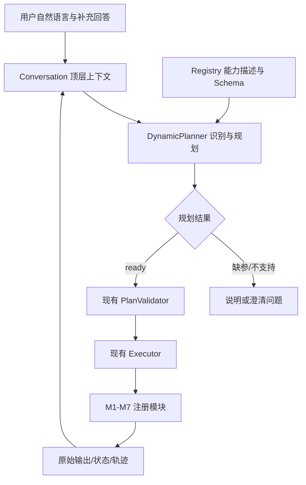

# 顶层语义路由、动态 Planner 与会话上下文

交付日期：2026-10-13。工作目录：`D:\模组\agent-hub`。

后续联网更新：顶层已接通本机 DeepSeek 环境变量，deepseek-flash 的七项真实测试通过；详细配置和边界见 [API 接通记录](planner_api_connection.md)。本文底部首次交付的离线记录作为历史保留，业务模块仍暂不做 API 联网验收。

本阶段已实现自然语言到动态计划、校验与执行的完整程序链路。遵循“先可用”的范围：复用现有 LLM 客户端和执行器，不加入额外审批 Agent、限流、数据库、复杂防护或分布式设施。

## 使用方法

在项目 `.env` 中填写 `LLM_BASE_URL`、`LLM_API_KEY`、`LLM_MODEL`，环境变量优先。Planner 沿用 `LLM_TIMEOUT_SECONDS`，示例配置为 120 秒，未配置也使用 120 秒；不增加独立超时层或网络重试。

```powershell
Set-Location 'D:\模组\agent-hub'
.\.venv\Scripts\python.exe -m hub_platform --goal '查询订单2025101234的物流状态'
.\.venv\Scripts\python.exe -m hub_platform --chat
.\.venv\Scripts\python.exe -m hub_platform --goal '分析2026年第41周经营并制定大促方案' --plan-only --json
.\.venv\Scripts\python.exe -m hub_platform --chat --real-m4 --real-m5
```

默认是“真实 LLM 规划 + 七个 Mock 业务模块”。`--real-m4`、`--real-m5` 分别替换对应模块。M4_MODE 只控制 M4，不会把顶部 Planner 或 M5 切成 Mock。现有 JSON 计划入口不需要 Planner LLM，继续可用。

`--chat` 的 `/new` 结束当前任务并保留历史；`/reset` 创建空白会话；`/context` 输出上下文快照；`/exit` 退出。无自动文件写入，退出程序后会话丢失。需要多轮澄清时使用 `--chat` 或 Python Conversation 对象，多个独立 `--goal` 命令不是同一会话。

## 结构和职责



- `hub_platform/planner.py`：一次正常模型调用同时完成单任务/复合任务识别和步骤生成；每次从 Registry 读取最新目录。没有 M1–M7 名称分支、关键词路由或固定业务链。
- `hub_platform/conversation.py`：内存会话、当前任务、澄清历史、执行结果以及顶层状态。模块只接收显式 payload 和 session_id 元数据，不拿到可修改的共享会话。
- `hub_platform/cli.py`：JSON 文件、`--goal`、`--chat` 三种入口；`--plan-only` 可预览自然语言生成的计划。
- 已有 Registry/Validator/Executor 核心逻辑未改。M4/M5 不依赖顶部 Planner 才能独立运行。

## 模型输出与执行

模型只返回下列结构，由程序生成 plan_id、保留用户目标并构建本地 ExecutionPlan：

```json
{
  "status": "ready",
  "message": "查询指定订单的物流状态。",
  "steps": [
    {
      "step_id": "s1",
      "capability_id": "m2.order_tracking",
      "depends_on": [],
      "inputs": {"order_id": {"literal": "2025101234"}}
    }
  ]
}
```

上述为协议示例，不是生产代码返回的固定计划。另外两种 status 为 `needs_clarification`、`unsupported`，两者 steps 必须为空，message 为实际问题或原因。

模型收到当前目标、会话上下文、实际历史报告、当日 UTC 日期、动态能力清单及输出 Schema。参数通过 literal/ref 显式绑定。上游可提供的字段使用 ref，信息不足的必需参数应询问用户，可选参数不强制追问；这些语义判断需要真实模型题集验证。

模型输出先解析再走现有 PlanValidator。非法 JSON、未知能力、缺参、错误引用或依赖等反馈给模型修正一次；仍失败则返回明确错误。修正次数可通过 DynamicPlanner 构造参数 max_repairs 调整。服务连接失败不做计划修正；业务执行失败不自动重规划或重复调用模块。

这是 Prompt + 本地 Schema 校验的实现，不依赖某供应商特定的强制结构化输出参数。没有把 FakeModel 作为运行时后备，缺少模型配置返回 TOOL_UNAVAILABLE/not_configured。

## 顶层上下文

SessionContext 保存 session_id、active_task 和 history。每个任务保存用户/平台消息、task_id、trace_id、最后计划、执行报告及状态。

- 澄清阶段沿用同一 task_id/trace_id，原任务和用户补充原文都传给 Planner；不让模型在后台维护不可见的“记忆摘要”。
- 用户明确修正的条件在 Prompt 中优先于旧条件，最终业务值仍需符合模块 Schema。
- 完成或明确不支持的任务在下一次输入时归入历史；执行失败的任务也保留真实报告，不自动重跑。
- 后续指代可以参考历史实际结果。历史步骤 ID 不可直接用作新计划 ref；要复用值，Planner 在新计划中绑定 literal。是否正确理解指代需真实模型验证。
- 保留完整会话，不在本版加入摘要、截断、向量记忆或跨进程存储；长会话的上下文长度和成本是后续优化项。
- context 属性返回深复制快照，返回结果的外部修改不会污染会话内部报告。
- 业务参数仍放 payload；目前模块 context 仅包含 session_id，模块内部状态由模块管理。

等待审批沿用原执行器边界：保存 report，后续消息不会让该任务重跑，也不伪装恢复成功。用户可 `/new` 开始另一个任务。真实 M7 已有模块内部 checkpoint/submit_decision；平台尚未实现统一 resume，不能跨 CLI 进程恢复 token。

## 输出与错误

TurnResult 包含 session_id、task_id、trace_id、status、message、plan、report、error、planning_attempts。规划日志只记录尝试结果及校验诊断，不要求模型输出隐藏推理。

单次入口退出码：0=completed/ready，1=failed，2=unsupported/CLI 参数错误，3=waiting_approval，4=needs_clarification。交互模式输出每轮状态并继续等待输入，退出会话返回 0。`--json` 单次为完整对象，会话为每轮一行 JSON。

最终可读输出由现有结果展示逻辑呈现，包含计划、各步骤实际结果及来源，不额外调用第二个回答模型。

## 验证与当前限制

全量回归：**247 passed, 14 skipped in 35.48s**。新增 41 项离线用例覆盖：

- 单能力计划；经营链和退款链的不同依赖图；注册新能力后不修改 Planner。
- 缺参澄清、用户预算修正、历史结果复用、不同会话隔离、快照与重置。
- 非法计划修正、修正后改为澄清、服务异常、耗尽修正次数、不执行非法计划。
- 预览不执行、模块失败不重规划、等待审批不重复执行。
- 新自然语言/交互 CLI，以及真实 M4/M5 代码与 Mock 组合接入。

离线测试中的 ScriptedModel/FakeLLM 仅验证协议、上下文传递和执行流程，不能证明模型理解语义。运行证据见 `tests/artifacts/planner_offline_demo.json`，明确标记 scripted responses，实际状态依次为 needs_clarification / completed / completed / waiting_approval。

14 项跳过包含原 M4 的 8 项外部 API 测试，以及新 Planner 的 6 道语义题。题集在 `tests/fixtures/planner_semantic_cases.json`，包含单订单、经营大促、订单退款、M4 代码请求、缺订单号、物理世界不可执行任务。

本地目前未配置 LLM_BASE_URL/LLM_API_KEY/LLM_MODEL，未开展真实调用，不提供语义准确率结论。配置后运行：

```powershell
$env:HUB_RUN_LIVE_TESTS='1'
.\.venv\Scripts\python.exe -m pytest tests/live/test_planner_live.py --run-live -q
```

该题集只向真实模型发送规划请求；随后使用业务 Mock 验证计划可执行性，不会触发真实退款或 M4 外部工具。
